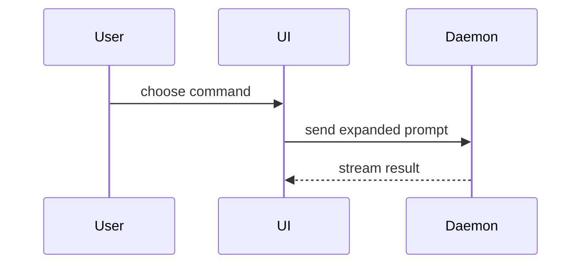

# PR

Every PR in this repository has the same title shape and the same body sections, so Maks and the reviewer read every PR the same way.
This file is the one template.
When a PR needs something the template lacks, add it here, in the same PR or in its own, and do not invent a private variant in the PR body.

`tools/scal_pr.py` reads the `##` headings of the template below and refuses to merge a PR whose body does not have each of them, in this order, as its own line.
Check a body before the review with `.venv/bin/python tools/scal_pr.py N --bez-merge`.

## Title

Conventional Commits, `type(scope): subject`, with the subject in Polish, imperative or nominal, no trailing period.
Types: `feat`, `fix`, `docs`, `refactor`, `test`, `ci`, `chore`, `perf`.
The scope is the area (`intermax`, `centrum`, `plan`, `agents`), and the subject names the real symbol or the behaviour that carries the change.

## Template

```markdown
## Why

<the goal and the problem, 1-3 sentences; `Closes #N` when the PR closes an issue>

## Summary

<diagram, diff-sketch, or tree>

## Evidence

- **Before:** <screenshot/output/failing test run>
  **After:** <screenshot/output/passing test run>

## Merge Danger

**Door:** <one-way or two-way>

<optional: description>

**Blast Radius:** <one-word description>

<optional: potential ramifications of merge>

<optional: **Decyzja Maksa:** a call only Maks can make, the default you applied, and what he could choose instead>

🤖 Generated with [Claude Code](https://claude.com/claude-code)
```

## Language and length

- Write the prose in Polish, with the terms of `GLOSSARY.md` (Komunikat, Zatrzymanie, Uruchomienie procesu, Wzorzec), and keep the template's headings and bold labels as they are.
- Skip preambles and keep prose brief: short sentences, one thought each.
  Keep it under about 40 lines: Maks and the reviewer read it in a minute.
  Long logs, tables of every run and lane recitals go into a PR comment or a file under `~/.t3/notes/<run>/`, linked from the body.
- The body describes the HEAD it is on.
  After a review round, rewrite the sections that changed instead of adding a section about what changed after the review: the history lives in the verdicts and comments.
- The repository is public: no client address, order or contract number, Wykonawca, row content of Dad's files, and nothing copied from a Zgłoszenie or a Kontrola ilości.
  Refer to a Zgłoszenie by number only (`Naprawia MAXIMISEART-AI/MAXIMISEART-Dad-zgloszenia#N`, `docs/agents/issue-tracker.md`).

## Why

Open with the goal of the person who asked for the change and the problem it solves, then the approach in one sentence.
No SHAs, rebase history or "based on main".
Name the issue the PR closes (`Closes #N`, which GitHub closes, or `Naprawia #N`, which `tools/scal_pr.py` closes after the merge) or serves (`Część #N`).

## Summary

Pick the smallest view that makes the key point clear.

- Show logic or an algorithm as pseudocode:

```text
on(save)
  if content is unchanged
    return cached result
  write new content
  return fresh result
```

- Show runtime control flow as a call tree:

```text
submitForm
  createSession
    persistPrompt
    launchAgent
  navigateToSession
```

- Show UI structure as a component tree, including state and module boundaries that matter:

```text
<SessionPage> (apps/example/src/routes/session.tsx)
  useSessionEvents()
  <SessionToolbar>
    <RunSkillButton> (packages/ui)
```

- Show file responsibility or a broad refactor as a shallow file tree:

```text
src/
├── commands/       # parses user actions
├── sessions/       # owns session state
└── transport/      # sends API requests
```

- Show component interaction, control flow, or data flow with Mermaid:



- Use `diff` when the point is what changes and the surrounding shape already exists.
  Match the diff shape to the topic.

For a component change:

```diff
 <SessionPage>
   useSessionEvents()
   <SessionToolbar>
+    <RunSkillButton />
   <SessionTimeline>
+    <SkillResultCard />
```

For a file-layout change:

```diff
 src/
 ├── commands/
+│   └── show-me.ts       # expands the slash command
 ├── sessions/
-└── transport.ts
+└── transport/
+    ├── client.ts
+    └── stream.ts
```

For a call-tree or call-stack change:

```diff
 submitForm
   createSession
     persistPrompt
+    expandSkillMention
     launchAgent
-  navigateToSession
+  navigateToSession
+    subscribeToEvents
```

For a state or control-flow change:

```diff
 on(save)
-  write content
+  if content is unchanged
+    return cached result
+  write new content
+  invalidate cache
```

- Show the whole block when most of it is new, when omitted context would hide ownership or order, or when the reader needs a copyable target shape.

- A change that Dad sees shows what he sees, before and after: the three parts of a Komunikat (Co się stało, Gdzie, Co zrobić), the text of a card, or the Excel cell he opens.
  When a committed expected-output file of a test changes, its diff is this view: paste the part that matters.

Place each visual next to the short text it supports.
Keep only the calls, files, props, states, and boundaries needed to understand the change.
You may use one of these, you may use several, it is unlikely you will use all of them.

## Evidence

Concrete evidence that the change works, as a before and an after.

- Screenshots and screen recordings are S-tier when the change is visual.
  `gh` cannot attach an image and the agent's Chrome is logged out of GitHub, so name the local path of the screenshot in the body and never commit it.
  A screenshot of Dad's real data never goes into the repository or the PR.
- Execution-based evidence is A-tier: the exact test that fails before and passes after, as pseudocode or as the command and its last line.
- Every number and every result in the body comes from a run you name (the command, or the CI run and its job), copied from its output, never counted again by hand.
  A result of a local run says it is local when CI decides differently (a warning locally, red in CI).
- Every promise in the body has its proof here.
  A behaviour the body claims has a test that fails when the behaviour breaks, shown with a mutation from `tools/mutacje.py` (`WYKRYTA`), and a sentence with no proof comes out of the body.
- A PR that adds or changes a check (a structure test, a lint rule, a CI job, a checking tool) shows its result on real history from `tools/na_scalonych_pr.py`: on the PRs whose review found the mistake it finds it, and on `--ostatnie 5` it raises no false alarm (`CODING_STANDARDS.md`).
- A measured speedup or regression gives one number with its unit, `before → after`, and links the rest.
- Name the `verify-*` skills from the `SKILLE VERIFY` line of `tools/skille_dla_zmiany.py` and the result of the part each one leaves local.
  `SZYBKO OK` alone is not evidence.

## Merge Danger

Describe whether it's a one-way or two-way door.
You can walk back through two-way doors, but not one-way doors.
A PR that is cheap to roll back is lower risk.

- Dad gets code only through a Wydanie (ADR 0014), so a merge to `main` reaches agents and CI first, and Dad only at the next Wydanie.
  Say when the change reaches him and what he notices then.
- A change is a one-way door when it changes what lies on Dad's disk and an older version must still read (Ustawienia taty, the metrics file, the queue of Zgłoszenia, Kopie INTERMAX), when it writes Dad's workbooks differently, or when it accepts an ADR.

The blast radius is the potential impact or scope of the changes introduced by this PR.
Consider all possibilities: a process and its Komunikaty, Centrum rozliczeń in Dad's browser, Windows only, the CI gate and its time, the tools agents run.

A question for Maks goes into the optional `**Decyzja Maksa:**` line, not into a section of its own.

## Credits

The Summary section's menu of visuals and its placement guidance come from [Dex Horthy](https://github.com/dexhorthy)'s `show-me` skill ([humanlayer](https://github.com/humanlayer/humanlayer)), through Maks's personal `pr` skill, which this file extends for this repository.
